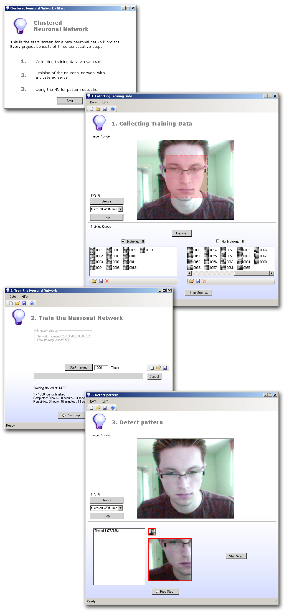

# Clustered Neuronal Network #

Studentenprojekt aus Heidelberg, entwickelt von Januar bis Mai 2008 auf Google Code (SVN). Im Oktober 2015 wurde es mit dem Google-Code-Exporter nach GitHub übertragen, die Commit-Daten stammen aus dem ursprünglichen SVN-Repository.

## Kurzinfo ##

  * Name: Clustered Neuronal Network
  * Website (Archiv): https://code.google.com/archive/p/clustered-neuronal-network/
  * Teilnehmer: Yves Oehlschläger, Johannes Hoppe, Johannes Hofmeister, Robert Gladewitz (Projektbetreuer)
  * Quellcode (C#, SVN-Historie 2008): im Branch [`master`](https://github.com/JohannesHoppe/clustered-neuronal-network/tree/master)
  * Alle Downloads: https://code.google.com/archive/p/clustered-neuronal-network/downloads
  * Download Milestone 1 (Mai 2008): [Quellcode](https://storage.googleapis.com/google-code-archive-downloads/v2/code.google.com/clustered-neuronal-network/clustered-neuronal-network_v0.1_rev0050_%28milestone1%29.zip), [Executable](https://storage.googleapis.com/google-code-archive-downloads/v2/code.google.com/clustered-neuronal-network/clustered-neuronal-network_v0.1_rev0050_%28milestone1%29.EXE.zip)
  * Projektdokumentation (Mai 2008): [PDF](https://storage.googleapis.com/google-code-archive-downloads/v2/code.google.com/clustered-neuronal-network/Projektdokumentation_final.pdf)
  * PPTX Präsentation: https://storage.googleapis.com/google-code-archive-downloads/v2/code.google.com/clustered-neuronal-network/Pr%C3%A4sentation%20CNN.pptx
  * PPTX Präsentation inkl. Informationen zum Windows CSS 2003: https://storage.googleapis.com/google-code-archive-downloads/v2/code.google.com/clustered-neuronal-network/Pr%C3%A4sentation%20CNN_%20incl%20HPC.pptx

## Microsoft CCS-Project ##

Das Projekt wurde für den Microsoft "CCS-Projekt-Wettbewerb" eingereicht und gewann im Rahmen des "Akademischen Programs" einen Forschungszuschuss sowie eine Reise nach Redmond zu Microsoft.

Eine Urkunde sowie ein Scheck wurden den Teilnehmern Johannes und Yves beim **"1. Treffen der deutschen Windows High Performance Computing Nutzergruppe"** in Aachen von Wolfgagn Dreyer überreicht.

  * Website des Treffens der 1. WinHPC Nutzergruppe: https://web.archive.org/web/20080529232531/http://www.rz.rwth-aachen.de/ca/c/ryy/lang/de/
  * Agenda der Veranstaltung: http://www.rz.rwth-aachen.de/global/show_document.asp?id=aaaaaaaaaabnawh (nicht mehr erreichbar)

## Abstract ##

Unser Projekt beschäftigt sich mit neuronalen Netzen zur Mustererkennung in Bilddaten. Wir haben ein Framework mit GUI entwickelt, welches die anfallenden Standardaufgaben komfortabel kapselt.

Hierzu gehört das Sammeln von Trainingsdaten über eine Webcam, das Training des Netzwerkes und die Mustererkennung von Video-Daten aus einer TV-Karte oder der Webcam. Projekte können geladen, verändert und enthaltene Details ausgetauscht werden.

Das Framework wurde darauf ausgerichtet das eingesetzte neuronale Netz zu variieren. Neben unserer Implementierung für eine CPU planen wir den Einsatz der CCS 2003 -Plattform um die Trainingszeiten zu verkürzen sowie eine Analyse des Videos in Echtzeit in verschiedenen Skalierungen zu ermöglichen.

Ziel ist es, ein System zu entwickeln, welches Gegenstände oder Logos im täglichen TV-Programm erkennt und so z.B. Marktbeobachtungen und Analysen der TV-Werbung unterstützt bzw. automatisiert.